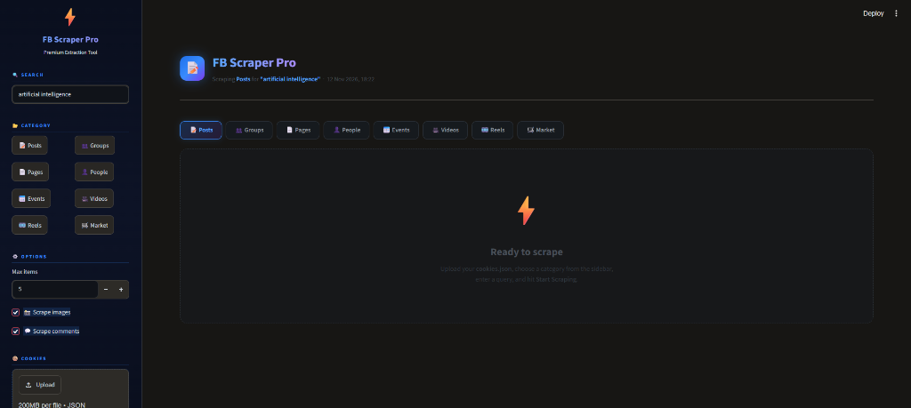

# ⚡ FB Scraper Pro

<div align="center">


**A powerful, browser-based Facebook search scraper with a sleek Glassmorphism dark UI.**  
Search and extract Posts, Groups, Pages, People, Events, Videos, Reels, and Marketplace items — all from a clean visual dashboard.

<br>

**👤 Author:** [Mina Wagih](https://github.com/MinaWagihz)  
**🎓 Supervised by:** [Eng. Mohamed Hemdan](https://github.com/mohamed66Hemdan)


</div>

---

## ✨ Features

| Feature | Details |
|---|---|
| 📝 **Posts** | Full text, author, timestamp, reactions, comments, images, post URL |
| 👥 **Groups** | Group name, link, description, member count |
| 📄 **Pages** | Page name, link, description, metadata |
| 👤 **People** | Profile name, link, metadata |
| 📅 **Events** | Event title, link, details |
| 🎥 **Videos** | Video title, link, thumbnails |
| 🎞️ **Reels** | Reel title, link, preview images |
| 🛒 **Marketplace** | Listing title, link, description, images |
| 📸 **Image Scraping** | Extracts real CDN-hosted photos (skips icons/avatars) |
| 💬 **Comment Scraping** | Captures commenter names + comment text (Posts only) |
| ⬇️ **Export** | Download results as **JSON** or **CSV** |
| 🖥️ **Live Log** | Real-time scraping progress log in the UI |
| 🎨 **Premium UI** | Glassmorphism dark theme with animated gradients |

---

## 🖥️ Screenshots

<p align="center">
  
</p>

> *Upload your cookies → choose a category → enter a query → hit Start Scraping*

**Dashboard (Empty State)**
```
⚡ Ready to scrape
Upload your cookies.json, choose a category from the sidebar, enter a query, and hit Start Scraping.
```

**After scraping**, you get stat cards showing:
- Items Scraped · Comments · Images Found · Total Reactions · Total Words

---

## 🚀 Quick Start

### Prerequisites

- Python **3.9 or higher**
- A Facebook account (cookies required for authentication)

---

### 1. Clone the Repository

```bash
git clone https://github.com/MinaWagihz/Facebook_scrapper.git
cd Facebook_scrapper
```

---

### 2. Create & Activate a Virtual Environment

**Windows (conda):**
```bash
conda create -n fb_env python=3.11
conda activate fb_env
```

**Windows (venv):**
```bash
python -m venv fb_env
fb_env\Scripts\activate
```

**macOS / Linux:**
```bash
python3 -m venv fb_env
source fb_env/bin/activate
```

---

### 3. Install Dependencies

```bash
pip install -r requirements.txt
```

Then install the Playwright browser engine:

```bash
playwright install chromium
```

> **Note:** Playwright downloads a Chromium browser (~150 MB) the first time. This is required for scraping.

---

### 4. Get Your Facebook Cookies

The scraper authenticates as **you** using your browser cookies. Here's how to export them:

#### Option A — Using a Browser Extension (Recommended)

1. Install [**EditThisCookie**](https://chrome.google.com/webstore/detail/editthiscookie/) (Chrome) or [**Cookie Quick Manager**](https://addons.mozilla.org/en-US/firefox/addon/cookie-quick-manager/) (Firefox)
2. Log in to [facebook.com](https://www.facebook.com)
3. Click the extension → **Export** → save as `cookies.json`

#### Option B — Using `browser-cookie3` (Python)

```bash
pip install browser-cookie3
python -c "
import browser_cookie3, json
cj = browser_cookie3.chrome(domain_name='.facebook.com')
cookies = [{'name': c.name, 'value': c.value, 'domain': c.domain,
            'path': c.path, 'secure': c.secure} for c in cj]
json.dump(cookies, open('cookies.json', 'w'), indent=2)
print(f'Exported {len(cookies)} cookies')
"
```

> ⚠️ **Keep your `cookies.json` private — it grants access to your Facebook account. Never commit it to GitHub.**

---

### 5. Run the App

```bash
streamlit run facebook_scrapper_ui.py
```

The app opens automatically at **http://localhost:8501**

---

## 🎮 How to Use

1. **Upload Cookies** — Click *"Upload cookies.json"* in the sidebar and select your exported file
2. **Enter a Query** — Type your search keyword (e.g. `artificial intelligence`, `python programming`)
3. **Choose a Category** — Click one of the 8 category buttons: Posts, Groups, Pages, People, Events, Videos, Reels, or Marketplace
4. **Set Options:**
   - **Max items** — how many results to scrape (1–100)
   - **📸 Scrape images** — toggle image extraction on/off
   - **💬 Scrape comments** — toggle comment extraction (Posts only)
5. **Click ⚡ Start Scraping** — watch the live log as results come in
6. **Download Results** — use the **⬇️ Download JSON** or **⬇️ Download CSV** buttons

---

## 📁 Project Structure

```
Facebook_scrapper/
│
├── facebook_scrapper_ui.py   # Main Streamlit app (UI + scraping logic)
├── requirements.txt          # Python dependencies
├── README.md                 # This file
```

---

## 📦 Output Format

### JSON (Full Detail)
```json
[
  {
    "id": 1,
    "scraped_at": "2024-11-08T15:30:00",
    "category": "post",
    "author": "John Doe",
    "timestamp": "November 7 at 10:23 AM",
    "post_url": "https://www.facebook.com/permalink/...",
    "content": "Post text content here...",
    "word_count": 42,
    "char_count": 240,
    "reactions": {
      "total": "1,234",
      "comments": "56",
      "shares": "12"
    },
    "images": ["https://scontent.fbcdn.net/..."],
    "comments_count": 3,
    "comments": [
      { "author": "Jane Smith", "text": "Great post!" }
    ]
  }
]
```

### CSV (Flat — no nested data)
Columns: `id`, `scraped_at`, `category`, `author`, `timestamp`, `post_url`, `content`, `word_count`, `char_count`

---

## ⚙️ Configuration

You can tweak scraping behavior directly in `facebook_scrapper_ui.py`:

| Setting | Location | Default | Description |
|---|---|---|---|
| `headless` | `scrape_posts()` / `scrape_generic()` | `False` | Set to `True` to hide the browser window |
| `slow_mo` | Browser launch | `60` ms | Delay between actions (increase if getting blocked) |
| `human_delay()` | Throughout | `2–5 s` | Random delay between actions to mimic human |
| `max_items` | Sidebar input | `5` | Max results (1–100) |
| Image limit | `extract_images()` | `8` | Max images per post |
| Comment limit | `extract_comments_rich()` | `15` | Max comments per post |

---

## 🛠️ Troubleshooting

### ❌ "Feed not found — check cookies / login"
- Your cookies may have expired. Re-export them from your browser.
- Make sure you're logged in to Facebook before exporting.

### ❌ Blank / empty results
- Facebook may have changed its DOM structure. Try increasing `slow_mo` to `150`.
- Try a different category or simpler search query.
- Check the Live Log panel for errors.

### ❌ `playwright install` fails
```bash
# Try installing with pip first
pip install playwright
python -m playwright install chromium
```

### ❌ App won't start / `ModuleNotFoundError`
- Make sure your virtual environment is **activated** before running.
- Run `pip install -r requirements.txt` again.

### ❌ Browser window closes immediately
- This is normal when scraping finishes. It is not an error.

---

## 🔒 Privacy & Legal Notice

> ⚠️ **For educational and research purposes only.**

- This tool uses **your own Facebook cookies** — it does not crack, bypass, or hack any authentication.
- Scraping Facebook may violate their [Terms of Service](https://www.facebook.com/terms). Use responsibly.
- Do **not** scrape personal data without consent.
- Do **not** use this tool for spam, harassment, or commercial data harvesting.
- The author is not responsible for misuse.

---

## 🤝 Contributing

Pull requests are welcome! For major changes, please open an issue first.

1. Fork the repo
2. Create your feature branch: `git checkout -b feature/my-feature`
3. Commit your changes: `git commit -m 'Add my feature'`
4. Push to the branch: `git push origin feature/my-feature`
5. Open a Pull Request

---

## 👥 Authors & Supervision

- **Author:** [Mina Wagih](https://github.com/MinaWagihz) ([@MinaWagihz](https://github.com/MinaWagihz))
- **Supervision:** [Eng. Mohamed Hemdan](https://github.com/mohamed66Hemdan)

---

## 📄 License

This project is licensed under the **Apache License 2.0** — see the [LICENSE](http://www.apache.org/licenses/LICENSE-2.0) for details.

Copyright © 2026 Mina Wagih. Supervised by Eng. Mohamed Hemdan.

---

  
